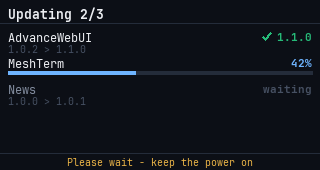

# Updates for CardputerZero

The CardputerZero AppStore updates one app at a time from its detail page and never tells you which apps are out of date. Updates lists every store app installed on the device with the installed and the latest version, and updates the ones you pick, or all of them, from the official store registry.

 

[Demo video](screenshots/demo.mp4) (22 s, recorded on the device)

- **List**: installed store apps, apps with an update first (`installed > latest`), the rest marked up to date. When any app has an update, an **Update all** button heads the list and is selected on start, so ENTER updates everything. The registry is fetched on start; without network the last fetched copy is used.
- **Update**: each package is downloaded from the registry URL and checked against the registry's size and SHA-256 and the expected package name and version. An `apt-get` dry run comes first: if installing would remove any other package (for example a library another app links against), that app is skipped and the reason shown.
- **Root**: installing needs root. Like the AppStore, the app asks for the `pi` user's sudo password once per batch (not asked when sudo needs none). It is checked with `sudo -v` and dropped when the batch ends; it is never stored or passed to apt.
- The AppStore's own record of installed versions is updated too, so the store shows the new version.

## Keys

| Screen | Key | Action |
|--------|-----|--------|
| List | F / X | Move up / down |
| List | SPACE | Pick / unpick an app with an update |
| List | ENTER | On Update all: update every app. On an app: update the picked apps (or that one) |
| List | A | Update all |
| List | R | Check again |
| List | Hold ESC 3 s | Exit |
| Confirm | type, ENTER | sudo password, start |
| Confirm | ESC | Cancel |
| Done | ENTER | Back to the list |

## Install

Build the package on the device:

```sh
sh build-deb.sh "Your Name <you@example.com>"
sudo dpkg -i zero-updates_1.0.0_all.deb
```

For development, copy this folder to `~/zero-updates` on the device and run `sudo sh ~/zero-updates/install.sh` to register it with the launcher.

Requires `python3`, `python3-pil` and `python3-numpy`.

## Development

```sh
python3 -m unittest test_zero_updates
python3 zero_updates.py --check                 # print installed store apps and versions
python3 zero_updates.py --preview out.png [--live] [--confirm] [--progress [--finished]]
```

Registry: `https://cardputerzero.github.io/generated/registry.json`. Downloads go to `~/.cache/zero-updates/downloads` and are deleted after a successful install.

## License

MIT
