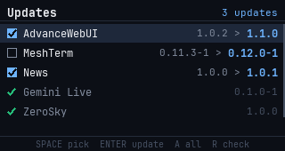

# Updates for CardputerZero

**Check for updates and install them all in one click.** The CardputerZero AppStore never tells you which apps are out of date, and updates one app at a time from its detail page. Updates checks every store app installed on the device against the official store registry, shows the installed and the latest version, and installs every update with one press of ENTER, or just the ones you pick.

 

[Demo video](screenshots/demo.mp4) (22 s, recorded on the device)

- **Check for updates**: runs on start (R checks again) with a progress bar. Installed store apps are listed with an update first (`installed > latest`), the rest marked up to date. Without network the last fetched registry is used.
- **Hand-installed apps**: a store app installed by copying files or by a script (a launcher entry in `/usr/share/APPLaunch` that no package owns) has no known version. It is listed as `manual > latest` and counts as an update, so installing the store package puts it under package management.
- **One-click update**: when any app has an update, an **Update all** button heads the list and is selected on start, so one ENTER (plus the sudo password) installs every update. To update only some apps, tick them with SPACE.
- **Safe install**: each package is downloaded from the registry URL and checked against the registry's size and SHA-256 and the expected package name and version. An `apt-get` dry run comes first: if installing would remove any other package (for example a library another app links against), that app is skipped and the reason shown.
- **Root**: installing needs root. Like the AppStore, the app asks for the `pi` user's sudo password once per batch (not asked when sudo needs none). It is checked with `sudo -v` and dropped when the batch ends; it is never stored or passed to apt.
- The AppStore's own record of installed versions is updated too, so the store shows the new version.

## Keys

| Screen | Key | Action |
|--------|-----|--------|
| List | F / X | Move up / down |
| List | SPACE | Pick / unpick an app with an update |
| List | ENTER | On Update all: update every app. On an app: update the picked apps (or that one) |
| List | A | Update all |
| List | R | Check again |
| List | Hold ESC 3 s | Exit |
| Confirm | type, ENTER | sudo password, start |
| Confirm | ESC | Cancel |
| Done | ENTER | Back to the list |

## Install

Build the package on the device:

```sh
sh build-deb.sh "Your Name <you@example.com>"
sudo dpkg -i zero-updates_1.0.1_all.deb
```

For development, copy this folder to `~/zero-updates` on the device and run `sudo sh ~/zero-updates/install.sh` to register it with the launcher.

Requires `python3`, `python3-pil` and `python3-numpy`.

## Development

```sh
python3 -m unittest test_zero_updates
python3 zero_updates.py --check                 # print installed store apps and versions
python3 zero_updates.py --preview out.png [--live] [--confirm] [--progress [--finished]]
```

Registry: `https://cardputerzero.github.io/generated/registry.json`. Downloads go to `~/.cache/zero-updates/downloads` and are deleted after a successful install.

## License

MIT
